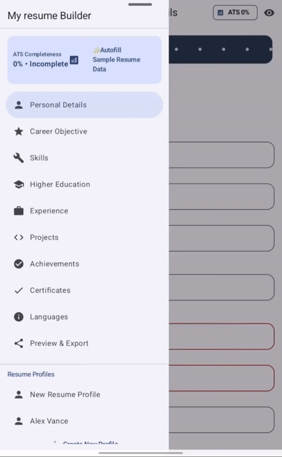
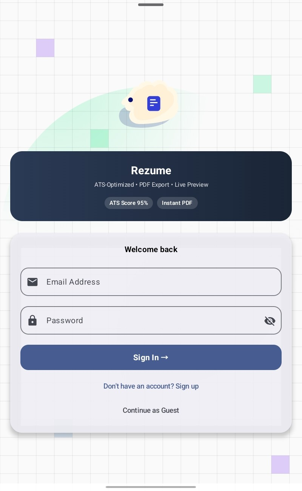
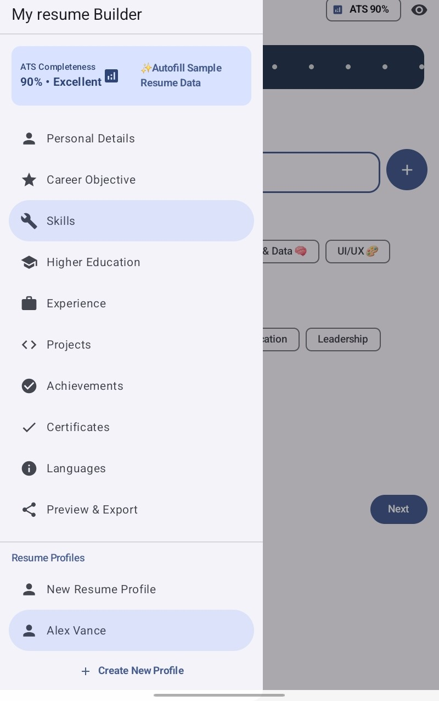
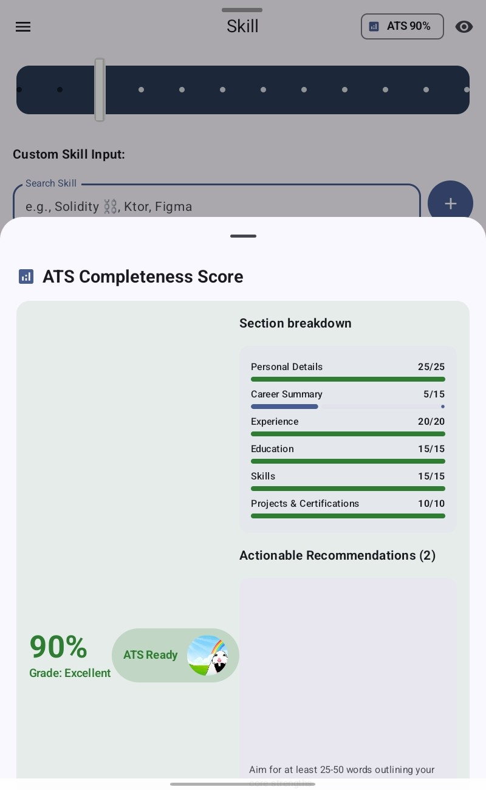
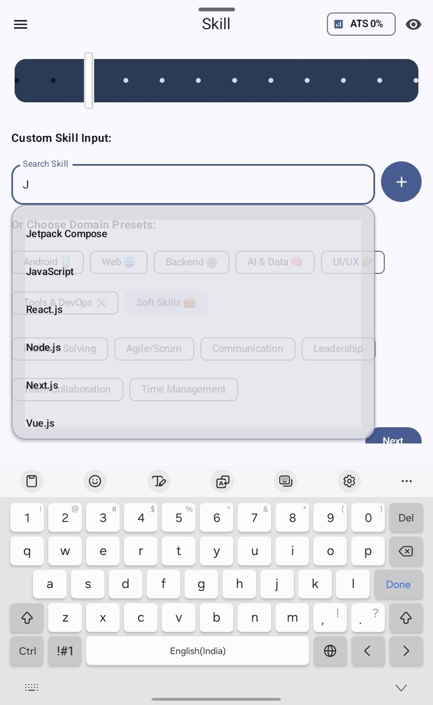
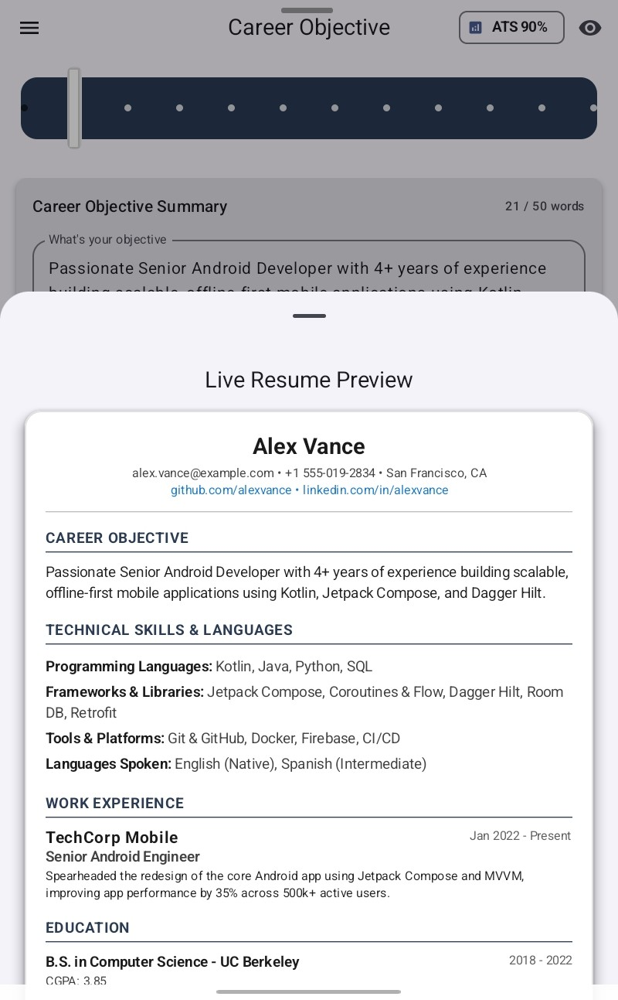
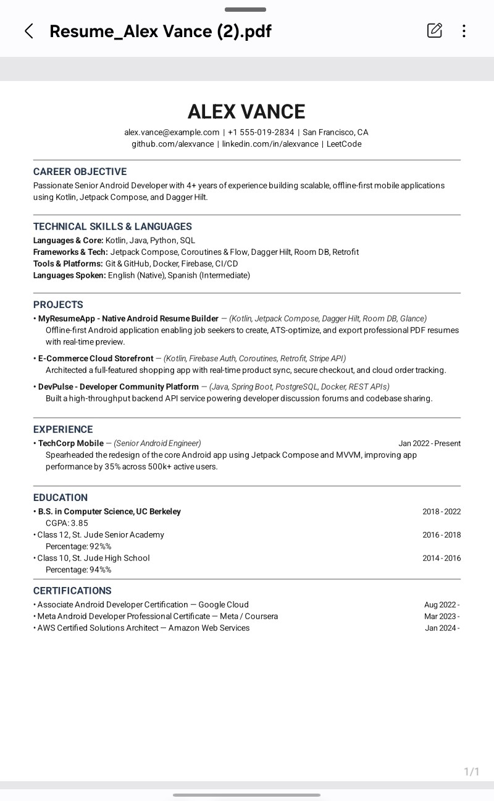

# 📄 Resume Builder Android App

A modern, native Android application built with **Kotlin**, **Jetpack Compose**, and **Dagger Hilt** featuring **Multiple Resume Profiles (Draft Manager)**, an **ATS Resume Completeness Engine**, **Spring-Physics Step Bar**, **Auth Theme**, **3D Hedgehog Mascot**, **Android 15 Edge-to-Edge Insets**, **Offline-First Architecture (Room Database v2 + WorkManager)**, **Home Screen Glance Widget**, **Compose UI Testing**, and an automated **CI/CD Pipeline (GitHub Actions)**. Allows users to create, preview, and export professional resumes as formatted PDFs, with automatic background synchronization to **Firebase**.

---

## 🎬 App Walkthrough & Demo



---

## 📸 App Screenshots

| **Login & Auth Screen** | **Navigation Drawer & Profiles** |
| :---: | :---: |
|  |  |

| **ATS Score Bottom Sheet** | **Domain Skill Picker** |
| :---: | :---: |
|  |  |

| **Live Resume Preview** | **Exported PDF Output** |
| :---: | :---: |
|  |  |

---

## 🚀 Features

- **Multiple Resume Profiles (Draft Manager)**: Create, manage, rename, and switch between multiple resume profiles seamlessly from the navigation drawer with Room Database persistence.
- **Real-Time ATS Score & Completeness Analyzer**: Evaluates 6 core resume sections (0–100%), grades completeness (*Excellent, Good, Needs Improvement*), and provides an interactive bottom sheet with mascot stickers and 1-tap "Fix" buttons that jump directly to incomplete fields.
- **Spring-Physics Step Progress Bar**: Interactive horizontal volume bar with drag gestures (`pointerInput`), 12 step dots, and bouncy spring snap physics (`Spring.DampingRatioMediumBouncy`) that snaps to step marks and switches editor screens dynamically.
- **Auth UI & 3D Hedgehog Mascot**: Custom Canvas square grid background with glowing color cells, show/hide password eye toggles, and an animated 3D Hedgehog Mascot (`HedgehogMascot.kt`).
- **Domain-Based Categorized Skill Picker**: 10+ domain presets (*Android, iOS, Web, Backend, AI/ML, Game Dev, Cybersecurity, UI/UX, Tools, Soft Skills*) with live glassmorphic autocomplete dropdown search.
- **Offline JSON Backup & Restore**: Export complete resume data to `.json` backup files or restore from existing JSON backups using Android's System File Picker.
- **1-Tap Sample Resume Autofill**: Pre-populates realistic multi-project and certification sample data across all 12 editor sections for instant testing.
- **Android 15 Edge-to-Edge Insets**: Full edge-to-edge system window integration with dynamic `.imePadding()` on all form screens for smooth soft keyboard adjustments.
- **Jetpack Compose UI Testing**: Comprehensive instrumented component test suite (`ResumeComponentsUiTest.kt`) verifying UI rendering for `ResumeCard`, `AtsScoreBottomSheet`, and `ResumeTopAppBar`.
- **Offline-First Capabilities**: Instantly saves resume data locally using Room Database so it persists even when offline or when the app is closed.
- **Background Cloud Sync**: Automatically syncs local changes to Firebase Realtime Database and Cloud Storage in the background using Android's WorkManager when a network connection is available.
- **Home Screen Glance Widget**: Interactive Jetpack Glance AppWidget displaying resume summary and providing quick-launch access directly from the home screen.
- **Automated Testing & CI/CD**: Fully tested repository layer with JUnit4 & MockK, backed by a GitHub Actions CI/CD pipeline that runs tests and builds on every push.
- **Intuitive UI**: Built entirely with Jetpack Compose and Material 3 guidelines, complete with a slide-out Navigation Drawer connecting all screens.
- **Smart Form UX**: Soft keyboard `Next`/`Done` focus navigation and auto-card generation.
- **Comprehensive Sections**: Personal details, Career Objective, Education with year validations, Work Experience, Projects, Certifications with "No Expiry" toggles, Languages with proficiency levels, and Achievements.
- **Native PDF Export**: Generates professionally styled, paper-aligned PDF documents using Android's native `PdfDocument` and Canvas API.

---

## 🛠️ Tech Stack & Architecture

- **Language**: [Kotlin](https://kotlinlang.org/)
- **UI Framework**: [Jetpack Compose](https://developer.android.com/jetpack/compose) & Material 3
- **Widgets**: [Jetpack Glance](https://developer.android.com/jetpack/compose/glance) (`androidx.glance:glance-appwidget`)
- **Dependency Injection**: [Dagger Hilt](https://dagger.dev/hilt/) & KSP
- **Local Database**: [Room Database](https://developer.android.com/training/data-storage/room) (Version 2 with multi-profile support) & Gson
- **Backup & Serialization**: [Gson](https://github.com/google/gson) (`JsonBackupUtils` for JSON document export & import)
- **Background Processing**: [WorkManager](https://developer.android.com/topic/libraries/architecture/workmanager)
- **Unit Testing**: [JUnit4](https://junit.org/junit4/) & [MockK](https://mockk.io/)
- **UI Testing**: Compose UI Test Rule (`ResumeComponentsUiTest.kt`)
- **CI/CD Pipeline**: [GitHub Actions](https://github.com/features/actions)
- **Architecture**: Clean Feature-Based MVVM with Offline-First Repository Pattern
- **Async & Concurrency**: Kotlin Coroutines & StateFlow
- **PDF Rendering**: Android Graphics `PdfDocument` & Canvas API
- **Image Loading**: [Coil](https://coil-kt.github.io/coil/) (`coil-compose`)
- **Backend / BaaS**: [Firebase](https://firebase.google.com/) (Auth, Realtime Database, Storage)
- **Build System**: Gradle 8.13 with Android Gradle Plugin 8.7.3 (Java 17)

---

## 📱 Project Structure

```text
com.example.myresumeapp/
├── components/                 # Global UI components
│   ├── AtsScoreBottomSheet.kt  # ATS score completeness bottom sheet
│   ├── HedgehogMascot.kt       # 3D animated hedgehog mascot
│   ├── ResumeCard.kt           # Paper-style resume document preview
│   └── ResumeTopAppBar.kt      # TopBar with ATS chip & SpringStepBar
├── core/                       # Shared utilities, theme, and DI modules
│   ├── di/                     # Hilt Modules (AppModule)
│   ├── theme/                  # Material 3 Color, Theme, and Typography
│   └── utils/                  # AtsScoreAnalyzer, JsonBackupUtils, PDFUtils, ImageUtils
├── data/                       # Data layer
│   ├── local/                  # Room Database, Entity, DAO, and TypeConverters
│   ├── model/                  # Data classes (ResumeData, UiState, Certificates, etc.)
│   ├── repository/             # Offline-First ResumeRepository
│   └── worker/                 # SyncResumeWorker (WorkManager background sync)
├── feature/                    # Feature-based presentation layer
│   ├── auth/                   # Login & Signup screens with SquareGridBackground
│   ├── editor/                 # Personal, Education, Skills, Experience, etc.
│   ├── preview/                # PreviewScreen & PDF/Image export
│   └── viewmodel/              # ResumeViewModel (HiltViewModel & Autofill)
├── navigation/                 # Navigation graph and routes (NavRoutes.kt)
├── widget/                     # Jetpack Glance Home Screen AppWidget & Receiver
├── MainActivity.kt             # Entry activity
└── MyResumeAppApplication.kt   # Hilt application container (@HiltAndroidApp)
```

---

## 🏁 Getting Started

### Prerequisites
- Android Studio (Koala / Narwhal or newer recommended)
- JDK 17
- Android SDK (Compile SDK 35/36, Min SDK 26)

### Installation & Setup
1. Clone the repository:
   ```bash
   git clone https://github.com/YOUR_USERNAME/MyResumeApp.git
   ```
2. Open the project in Android Studio.
3. Add your `google-services.json` file inside the `app/` directory (required for Firebase integration).
4. Sync project with Gradle/JDK set to **Java 17**.
5. Run the app on an Android emulator or physical device.

---

## 📄 License

This project is open-source and available under the [LICENSE](LICENSE).
